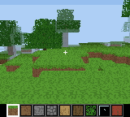
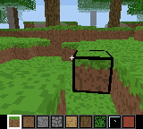

# Voxel game on the Chromatic

`--with-voxel` builds the CPU application SoC (`--with-app`: VexRiscv, main RAM in the PSRAM, PSRAM
frame buffers, PCM audio, buttons) with a **VoxelRenderer**: a hardware raycaster that draws the 3D
view of a Minecraft-like block world into the LCD frame buffers (so also over UVC). The game
(`firmware/voxel`) runs on the CPU: world generation, player physics, block picking/editing, hotbar,
day/night cycle, sound effects. Creative mode.

Status: **runs on the Chromatic at ~52 fps** (hardware 3D view: 18.9ms per frame), playable with the
console buttons, with sound, captured over UVC; the hardware frames are identical to the software
renderer's (`--args sw`, 1 fps). Also on the PC (SDL, same game code).

 

## Architecture

```
CPU firmware (VexRiscv, 67MHz)                  VoxelRenderer gateware (sys = xClk)
- world 256x256x32 (1 byte/cell, 2MB, PSRAM)    - world window RAM: 32x32x32 cells x 4 bits (8 BSRAM),
  value-noise terrain, water, beaches, snow,      toroidal on X/Z: the CPU only writes the columns
  trees, ores; X/Z wrap around                    entering the window when the player moves/turns
- player: AABB collisions, gravity, jump, fly,  - textures: 16 x 16x16 x 8-bit texels (2 BSRAM)
  swim; block picking (1/16 cell ray march)     - per pixel: ray = fwd + (x-80)*right + (y-64)*down,
- camera vectors (Q14), window origin ahead       delta = 2^26/|d| (3 restoring dividers, 2 bits/
  of the camera, palette (day/night, fog)         cycle), 3D DDA (2 cycles/step, <= 64 steps), hit:
- hotbar (CPU-written HUD rows 128-143)           texel (t*d products, 3 shared DSPs), shade = face +
- sounds (noise bursts/sweep, PCM IRQ)            fog, sky gradient, selection edges, crosshair
                                                - 160-pixel lines written into the LCDPSRAMFramebuffer
                                                  line buffers (hardware port), copied to the PSRAM
                                                  back buffer as the CPU lines (palette lookup)
```

The 3D view is 160x128 (rows 0-127), the hotbar uses the bottom 16 rows.

## Bit exact reference model

`firmware/voxel/vr.c` is the reference model of the gateware and also the software renderer (PC
build, `--with-app` builds without the renderer, `--args sw`). `test/test_voxel.py` checks every
pixel against it:
- Migen simulation (rows): terrain, axis-aligned rays (zero direction components), selection,
  window across the world wrap, sky.
- **The generated Verilog** (Verilator, `test/voxel_tb.cpp` linked with `vr.c`): whole frames of
  the same scenes with strong fog (all shades), in seconds. Migen's simulation evaluates expressions
  with Python integers, Verilog with the operands' widths: `(level + fog[:3]) > 7` was a 3-bit
  comparison in Verilog (the sum wrapped: far leaves not fogged on the hardware, 8 pixels of a
  frame), which only this test (and the hardware) showed. Sums used in comparisons are computed in
  their own signals.
- The tests and `hal_sdl.c` share a scene/camera file format (`VOXEL_DUMP=file`
  `VOXEL_DUMP_FRAME=n`): a frame of the PC game can be replayed on the gateware.

Any change of the rendering must be done in both.

Formats (`vr.h`):

| | |
|---|---|
| World window | 32x32x32 cells, 4-bit blocks (0: air), word `(y << 7) \| (z << 2) \| (x >> 3)`, nibble `x & 7`; X/Z toroidal (`cell & 31`) |
| Textures | 16 textures of 16x16 texels, 8-bit (bits 4:0: color, 0: transparent), word `(t << 6) \| (v << 2) \| (u >> 2)`, byte `u & 3` |
| Blocks | 16 entries: textures of the top (3:0), sides (7:4), bottom (11:8) |
| Camera | cell (X/Z mod 256, Y 0-31) + fraction (Q8), fwd/right/down vectors (Q14, fwd unit and orthogonal to right/down: t is the view depth) |
| t | Q12, 24-bit, saturated (`0xffffff`: never) |
| Pixel | `(color << 3) \| shade`, shade = min(7, face + max(0, t - fog_start) >> fog_shift), faces: top 0, Z 1, X 2, bottom 3 |
| Sky | `sky_base \| clamp(4 - (dy >> 12), 0, 7)` |
| Rays end | after t_far, out of the window `[origin, origin + 31]` (X/Z), out of the world height, after 64 steps: sky |

Palette (`art.c`): 32 colors x 8 shades (shades 0-3: darker faces, 4-7: fog toward the horizon
color), color 31: sky gradient (zenith to horizon), 28-30: UI. Textures are generated (no assets).

## Build and run

```bash
./chromatix.py --gowin-path ~/tools/gowin_1.9.12.04/IDE --with-voxel --build --output-dir build_voxel
./scripts/chromatix_flash.py flash build_voxel/gateware/chromatic.fs
make -C firmware/voxel BUILD_DIR=../../build_voxel
./scripts/chromatic.py --serial /dev/ttyACM0 run firmware/voxel/voxel.bin   # --args "seed=42", "sw"
./scripts/chromatic.py capture voxel.png
```

PC build (SDL, software renderer, same game code): `make -C firmware/voxel -f Makefile.host &&
firmware/voxel/voxel_host` (keys: arrows, X: A, Z: B, Enter: Start, Backspace: Select).
`VOXEL_SCRIPT`/`VOXEL_SNAP`/`VOXEL_FRAMES` script the buttons and save frames (tests, see
`hal_sdl.c`).

## Controls

| Button | Action |
|---|---|
| D-pad up/down | walk forward/back |
| D-pad left/right | turn |
| Select + D-pad | look up/down, strafe |
| A | place the hotbar block |
| B | break the targeted block |
| Start | jump (swim up in water; fly: up) |
| Start twice | fly on/off |
| Select + Start | fly: down |
| Select + A / B | next/previous hotbar block |

## Performance

Hardware, spawn view (`host` block frames counter, `voxel_cycles` CSR):

| Renderer | fps | 3D view (160x128) | Notes |
|---|---|---|---|
| Software (CPU 67MHz, `vr.c`, `--args sw`) | 1.05 | ~950ms | 3 divisions + a DDA per pixel on the CPU |
| **VoxelRenderer** | **52.4** | **18.9ms** (62.1 cycles/pixel) | the CPU waits for the render (game logic + HUD: ~0.2ms) |

Next steps if needed: overlap the game logic with the render (render frame n while updating n+1),
2 rays in flight (the DDA waits for the world RAM 1 cycle out of 2), radix-4 dividers.

## Resources

| | Logic | BSRAM | DSP | xClk Fmax |
|---|---|---|---|---|
| `--with-app` (synthesis) | 16751 | 44 | 4 + 21 small | |
| VoxelRenderer alone (synthesis) | ~2.7K | 10 | 3 + 1 small | 91MHz |
| **`--with-voxel`** (place and route) | 18698 (82%) | 47/56 | 21/28 | 75.6MHz (67.1MHz) |

What it took to fit (lessons):
- **Shared multipliers**: the first version used 12 (setup, hit, row base); the products are now
  shared (setup and hit never at the same time) and the row base uses shifts and adds.
- **Separate hardware line buffers**: muxing the renderer onto the framebuffer's line buffer write
  port made Gowin implement that memory (160x32) in flip-flops (8192 registers, +8K logic: 25.2K,
  did not fit). The renderer has its own line buffer memory (1 BSRAM), the copy engine selects the
  source per slot. The line buffers are copied in order: the renderer continues the CPU's slot
  sequence (`control.slot`, 128 lines: a multiple of the 4 slots).
- **No L2 cache** (its 11 BSRAM go to the world/textures RAMs; 62 BSRAM with it). Without an L2,
  the CPU's 32-bit (and byte) stores reach the PSRAM bridge as partial 64-bit writes, which it
  didn't support (sel ignored: neighbors overwritten): `PSRAMWishbone` now writes the selected
  16-bit words when they start at the bus word, else does a read-modify-write of the bus word. On the
  hardware, write bursts starting 4 bytes into an 8-byte word were found not to reach the PSRAM
  (simulation model fine, root cause not found): only bus word aligned bursts are used.
- **No ESP32 UART/USB link** (`CDCLink`, SDR streaming) in the voxel build: their CSR paths were the
  critical ones (64.6MHz); without them 18.6K logic and the timing is met with margin.
- The DDA step selection (nearest boundary, next cell, window/height checks) is precomputed in
  registers during the world RAM read cycle (was the critical path).

## Known issues / next

- View distance: the 32x32x32 window, placed up to 8 cells ahead of the camera (fog hides its edges);
  world height 32.
- No saves (no filesystem), no mobs/inventory (creative mode only), simple procedural sounds.
- The CPU idles during the render (see Performance), the CDC port is the debug bridge only (no
  application UART/DMA link in this build).
- PSRAM write bursts not aligned on the 8-byte bus word: root cause not found (see Resources).
